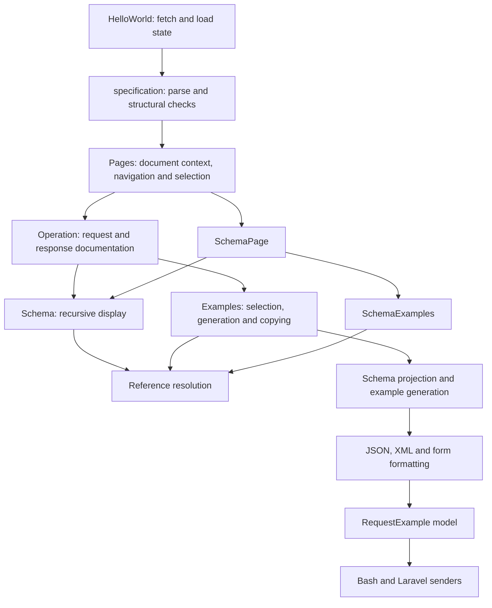

# Architecture audit

Reviewed 2026-10-09. Scope: loading, local references, navigation, schema interpretation, examples, request serialization, and component boundaries. This is a review of the current implementation, with targeted runtime probes; it is not a full OpenAPI conformance or browser accessibility assessment.

## Main conclusion

The code has reasonably small modules and useful pure helpers. The principal architectural problem is that raw OpenAPI objects remain the working model throughout the application. Each consumer independently decides how references, compositions, examples, and inheritance work. Small modules therefore still contain overlapping interpretations of the same domain.

The highest-value change is a small shared domain layer with stable identities, explicit outcomes, and preserved constraints. Introduce it incrementally around the existing helpers. A data structure makes missing cases explicit; correctness still requires implementing and testing the operations on that structure.

## How the application currently works



`references.ts` is already shared, `effectiveParameters` already uses a composite-key Map, and Bash/Laravel already share a request model. These are good foundations. The gaps below are mostly places where the next structure is missing or loses information.

## Findings, ordered by priority

### 1. P1 — Composition generation silently produces samples that violate the schema

Locations: [schemaExamples.ts:10](src/components/OpenApi/schemaExamples.ts#L10), [schemaExamples.ts:72](src/components/OpenApi/schemaExamples.ts#L72), [schemaExamples.ts:85](src/components/OpenApi/schemaExamples.ts#L85).

Confirmed by calling `createSchemaExample`:

| Input | Actual generated value | Problem |
| --- | --- | --- |
| Object with required `shared`, a `shared` property, and `oneOf: [{properties: {branch: {type: 'string'}}}]` | `{"branch":"string"}` | The enclosing required property is omitted. |
| `oneOf: [{type: 'integer'}, {type: 'number'}]` | `0` | It matches both branches. |
| `allOf` of a closed object permitting only `a` and another object defining `b` | `{"a":"string","b":"string"}` | `b` violates the first member's `additionalProperties: false`. |

The generator chooses a branch, but the constraint checker does not check `required`, closed-object restrictions, or `oneOf`/`anyOf`. The composition branch also bypasses generation of enclosing properties. `Object.assign` combines examples without preserving which constraints each object must independently satisfy.

`oneOf` requires exactly one matching subschema; enclosing assertions continue to apply. See [JSON Schema Core](https://json-schema.org/draft/2020-12/json-schema-core#section-10.2.1.3) and [required-property semantics](https://json-schema.org/draft/2020-12/json-schema-validation#section-6.5.3).

**Structure to introduce:** a constraint expression that preserves local assertions and every applicator together:

```ts
type ConstraintNode = {
  assertions: SupportedAssertions
  allOf: SchemaId[]
  anyOf: SchemaId[]
  oneOf: SchemaId[]
}
```

Do not encode composition as an exclusive choice between “object” and “union”: both can occur on the same schema. Generation should propose a value and evaluate it against the complete supported expression. Return an unavailable result when supported constraints cannot be satisfied. Unknown constraints should leave validation status explicit rather than pretending the result is validated.

This does not require solving arbitrary JSON Schema. The existing documentation already acknowledges partial composition validation; these cases nevertheless affect visible, copyable samples using keywords the viewer displays.

### 2. P1 — Reference expansion loses graph sharing and invents null schemas at recursion boundaries

Locations: [schemaExamples.ts:33](src/components/OpenApi/schemaExamples.ts#L33), [Schema.vue:50](src/components/OpenApi/Schema.vue#L50), [compositionExamples.ts:8](src/components/OpenApi/compositionExamples.ts#L8).

`resolveExampleSchema` recursively copies every reachable property/item/composition. A synthetic acyclic schema with 13 unique nodes, where each object has two properties pointing to the same next node, becomes **8,191 copied schema nodes**. A second probe using 13 named schemas connected by local `$ref` targets produced the same expansion. A per-path ancestor Set prevents cycles but does not prevent repeated expansion of shared descendants.

Display repeats this work to decide whether each property is visible. Media selection, value generation, formatting, and diagnostic collection independently invoke resolution again. This is a structural amplification risk, not a measured claim about normal-spec latency.

At recursion boundaries the resolver substitutes `{type: 'null'}`. A required, non-null recursive `Node.next` produces `{"next":null}` without a reference diagnostic. Recursion is being converted into a new constraint that the source never declared.

**Structure to introduce:** a document-scoped schema graph:

```ts
type SchemaGraph = {
  nodes: Map<SchemaId, SchemaNode>
  pointerTargets: Map<CanonicalPointer, SchemaId>
}
```

Keep references as edges; preserve conjunction edges for 3.1 siblings. Give inline nodes and sibling wrappers stable identities as well. Cache pointer lookup and shallow resolution per document and reference kind. Keep selections/direction outside the immutable graph.

Traverse lazily with an active-node Set and explicit work/depth budgets. An optional recursive property can be omitted when allowed; a required cycle without a finite supported branch should produce `unavailable: recursive-required-value`, not invented null. Cache graph nodes, not ancestor-dependent null substitutions. Output generation still needs a size budget because the resulting JSON value itself may legitimately grow exponentially.

### 3. P1 — Lossy operation identifiers make valid endpoints unreachable

Locations: [utils.ts:96](src/components/OpenApi/utils.ts#L96), [Pages.vue:62](src/components/Layouts/Pages.vue#L62), [Pages.vue:91](src/components/Layouts/Pages.vue#L91).

With no authored `operationId`, `GET /a-b` and `GET /a/b` both become `operations/get--a-b`. `Pages` selects with `.find`, so both links select the first operation. This is a collision in a valid document, not only an invalid duplicate `operationId` case.

The same string is used as route identity and Vue navigation key. Folder names also share the navigation-key space with operation IDs. Separately, unknown routes leave every page condition false and show blank content, as the existing release audit already notes.

**Structure to introduce:** a page registry with a reversible internal identity:

```ts
type Page =
  | {kind: 'overview'}
  | {kind: 'operation'; method: HttpMethod; path: string; model: OperationModel}
  | {kind: 'webhook'; method: HttpMethod; name: string; model: OperationModel}
  | {kind: 'schema'; name: string; schemaId: SchemaId}

type PageRegistry = Map<PageId, Page>
```

Use a tuple such as `['operation', method, originalPath]` as the source of identity, with a reversible route encoder. Preserve current authored-operation routes as compatibility aliases when unambiguous; diagnose ambiguous aliases. Use a separate namespace for folder keys. Resolve the selected page once, including a missing-page outcome.

Store effective parameters, resolved Path Item context, and effective server information in `OperationModel`. Today `Pages` builds effective operations, reconstructs a one-entry `Paths` object, and `PathItem.vue` interprets it again. Rendering the selected model directly removes that round trip. A folder Map also replaces repeated `acc.find` scans during search.

### 4. P2 — JSON and XML independently choose composition branches

Locations: [schemaExamples.ts:85](src/components/OpenApi/schemaExamples.ts#L85), [xmlExamples.ts:16](src/components/OpenApi/xmlExamples.ts#L16), [schemaUsage.ts:20](src/components/OpenApi/schemaUsage.ts#L20), [compositionExamples.ts:8](src/components/OpenApi/compositionExamples.ts#L8).

Confirmed with `oneOf: [nullSchema, personSchema]`, where the person schema declares XML root `person` and an attribute `name`:

- JSON generation chooses the non-null person branch and returns `{"name":"string"}`.
- XML chooses member zero and emits `<root><name>string</name></root>` instead of using the person's root and attribute metadata.

Direction filtering uses yet another branch heuristic, based on const/enum matches or the first non-null member. Explicit UI selection projects a separate schema copy and removes authored examples on affected ancestors. There is no durable record of which branches produced a value.

**Structure to introduce:** an example plan carrying the value and branch provenance:

```ts
type ExamplePlan = {
  value: JsonValue
  origin: 'authored' | 'generated'
  branches: ReadonlyMap<SchemaOccurrenceId, SchemaId>
  direction: SchemaDirection
}
```

Generate/project once. Direction filtering and XML metadata lookup consume the same plan. Occurrence identity must include the usage path: the same reusable schema can have different selected branches at different occurrences. Preserve original constraints separately from the projection so selecting a `oneOf` branch does not discard the exact-one rule during checking.

### 5. P2 — The request model cannot distinguish absent, empty, structured and raw bodies

Locations: [requestExamples/types.ts:1](src/components/OpenApi/requestExamples/types.ts#L1), [requestExamples/index.ts:18](src/components/OpenApi/requestExamples/index.ts#L18), [requestExamples/bash.ts:13](src/components/OpenApi/requestExamples/bash.ts#L13), [requestExamples/laravel.ts:25](src/components/OpenApi/requestExamples/laravel.ts#L25).

`RequestExample` simultaneously stores `body`, `value`, `formFields`, optional files, and a content-type string. Senders infer the intended representation again from these overlapping fields.

Confirmed:

- A supplied `text/plain` empty string becomes a request with a Content-Type header but no explicit body action in either sender. The model has collapsed the distinction between a supplied empty value and no body.
- A supplied raw multipart string `raw-body` is accepted during formatting but silently discarded by both senders, which use empty form fields instead. The request remains copyable.

**Structure to introduce:** a discriminated body union:

```ts
type RequestBodyValue =
  | {kind: 'none'}
  | {kind: 'text'; contentType: string; text: string}
  | {kind: 'json'; contentType: string; value: JsonValue}
  | {kind: 'urlencoded'; fields: readonly Field[]}
  | {kind: 'multipart'; parts: readonly MultipartPart[]}
  | {kind: 'file'; contentType: string; filename: string}
```

Multipart parts should distinguish text from file parts. A raw multipart representation needs explicit boundary metadata or an unavailable result. Senders should exhaustively switch on `kind`; they should not decide media semantics. Empty text remains a text body.

Build one model result containing diagnostics and availability. `Examples.vue` currently runs `formatMediaExample` again solely to collect issues, separately from actual generation, and each panel reconstructs similar success/error objects. A shared result removes this duplicate work and prevents diagnostics drifting from the selected value.

### 6. P2 — Schema example values are confused with OpenAPI Example Objects

Locations: [types.ts:27](src/components/OpenApi/types.ts#L27), [schemaExamples.ts:61](src/components/OpenApi/schemaExamples.ts#L61), [Schema.vue:65](src/components/OpenApi/Schema.vue#L65).

Schema `examples` are modeled as `(string | Example)[]`, and any object with a `value` property is treated as an Example Object. Therefore a schema example `examples: [{value: 'actual payload', unit: 'kg'}]` becomes the string `actual payload`, losing the rest of the payload. Display repeats the same interpretation. Existing tests explicitly encode this compatibility behavior, so they reinforce the ambiguity.

Schema examples are instance values; media/parameter named examples are Example Objects. These are different source contexts. See [JSON Schema examples](https://json-schema.org/draft/2020-12/json-schema-validation#section-9.5) and the [OpenAPI Media Type Object](https://spec.openapis.org/oas/v3.1.0.html#media-type-object).

**Structure to introduce:** `JsonValue` for raw schema examples and a separate `NamedExample` record for named Example Objects. Normalize based on source location, not the payload's property names. If a legacy wrapped schema-example mode is retained, make it explicit rather than inferring it from `value`.

### 7. P2 — Response headers lose metadata when converted into an object schema

Location: [ResponseContent.vue:19](src/components/OpenApi/Partials/ResponseContent.vue#L19).

The header model is reduced to `description` plus one schema. This drops header-level examples, `required`, `deprecated`, and serialization settings. Content-based headers lose their media type and media-level examples because only the first content schema is kept. Reference resolution succeeds, but the adaptation discards information before display.

**Structure to introduce:** a header field model retaining metadata and its representation:

```ts
type HeaderField = {
  name: string
  required: boolean
  deprecated: boolean
  description?: string
  representation: SchemaRepresentation | ContentRepresentation
}
```

Share the field-details renderer with parameters where semantics match, rather than disguising headers as schema properties. `ParameterDetails.vue` already shows why field metadata belongs above the schema.

### 8. P2 — Link previews reconstruct reference identity differently from the resolver

Locations: [schemaTypePreview.ts:15](src/components/OpenApi/schemaTypePreview.ts#L15), [SchemaTypePreview.vue:14](src/components/OpenApi/SchemaTypePreview.vue#L14), [localReferences.ts:26](src/components/OpenApi/localReferences.ts#L26).

The resolver decodes the URI fragment and JSON Pointer tokens. Type previews split the raw reference string and decode only tilde escapes. Confirmed: `#/components/schemas/A%20B` resolves to the component named `A B`, but the preview returns `schemaName: 'A%20B'`. The component lookup fails and the valid reference has no link.

**Structure to introduce:** a canonical pointer identity returned by the shared resolver, including decoded tokens and target node ID. Link construction should look up the target in the page registry. `SchemaTypePart` should carry `targetPageId`, not an independently inferred component name. This also allows aliases to link to a known target without parsing references in presentation code.

## Further simplifications

These are secondary to the confirmed issues above:

- **One document context.** `HelloWorld` retains both `document` and `specification`, provides the former, and passes document/components/paths to `Pages`, which reconstructs and provides another document. Use one context containing original document, source URL, dialect, resolver, and indexes. Keep components-only helper fallbacks at an explicit compatibility boundary so absent version information cannot silently choose 3.0 policy throughout the core.
- **Context-aware structural checks.** `specification.ts:65` traverses by keyword names with dictionary flags and special Link contexts. Replace growing global keyword exceptions with a small table of object kinds and field rules; payload examples should have an explicit opaque-data kind. This is a maintainability recommendation, not a newly confirmed validation bug.
- **Typed response entries.** `Responses.vue:11` partitions into two untyped dictionaries once during setup; `Response.vue` declares status as a number while header/selection code uses strings. Use a computed `ResponseEntry[]` with string status, then first/rest views. A status classification union can represent concrete codes, ranges, and default if richer behavior is needed. This also avoids stale grouping if props are replaced without remounting; current navigation remounting largely hides that issue.
- **Shared type-preview representation.** `utils.ts` and `schemaTypePreview.ts` contain overlapping recursion for unions, arrays, tuples, refs, and nullability. Produce `SchemaTypePart[]` once and join its text for plain previews.
- **Explicit load state.** Replace independent state/message/specification/source-url refs with `loading | ready(document, sourceUrl) | error(message)`. Retain cancellation/revision logic, which already handles stale requests well.
- **One source catalogue.** The commented URLs and mirror mapping in `HelloWorld` overlap the comparison selector in `ComparisonCanvas`. A typed source catalogue can provide URL, display label, and original source URL in one place.

## Suggested implementation order

1. Restore the normal build and add regressions for the confirmed failures. Use computed response entries and correct string statuses; the remaining Paths error concerns the inferred dictionary key type.
2. Introduce the page registry and effective operation model. This is a small, independently reviewable change that fixes unreachable endpoints and removes the selected-operation-to-Paths round trip.
3. Introduce the request body union and a shared result type. Preserve sender outputs for supported existing cases; add empty-text and raw-multipart checks.
4. Introduce the document-scoped schema graph behind existing resolver interfaces. Preserve reference sibling semantics and add graph sharing and budget regressions before migrating consumers.
5. Add the example plan and complete evaluation of the supported constraint subset. Migrate JSON/XML/direction filtering together, retaining authored-example policy explicitly.
6. Migrate headers and example normalization; consolidate preview parsing and document context as consumers move over.

The first three steps provide concrete benefits without a broad rewrite. The graph and constraint work deserve separate changes because preserving conjunction meaning is more important than reducing line count. Shared data structures will remove duplicate traversals and decisions, but a correct evaluator may add code while making behavior easier to understand.

## Verification and limits

- `node --test tests/localReferences.test.mjs tests/schemaViewer.test.mjs tests/specSafety.test.mjs tests/requestExamples.test.mjs`: **92 passed**. Vite printed sandbox WebSocket-listen warnings; test processes exited successfully.
- `yarn build`: **failed with four TypeScript errors**, in `ResponseHeader.vue:49`, `Responses.vue:13` and `:15`, and `Paths.vue:17`. These agree with the existing release audit.
- Targeted Vite SSR helper probes confirmed composition outputs, recursive null substitution, graph expansion with both shared objects and JSON pointers, operation-ID collision, XML branch disagreement, request body omissions, schema-example ambiguity, and encoded-reference preview identity.
- Header metadata loss and simplification recommendations follow directly from source inspection. The separate TypeScript test files and a full browser session were not run during this audit.
- General composition validation is already disclosed as partial in `SCHEMA_SUPPORT.md`; this audit explains concrete failure modes and an architectural way to manage them. External references, discriminators, and full JSON Schema support were not treated as accidental regressions.
- Application code was not changed. This report complements the release checklist in `AUDIT.md`.
