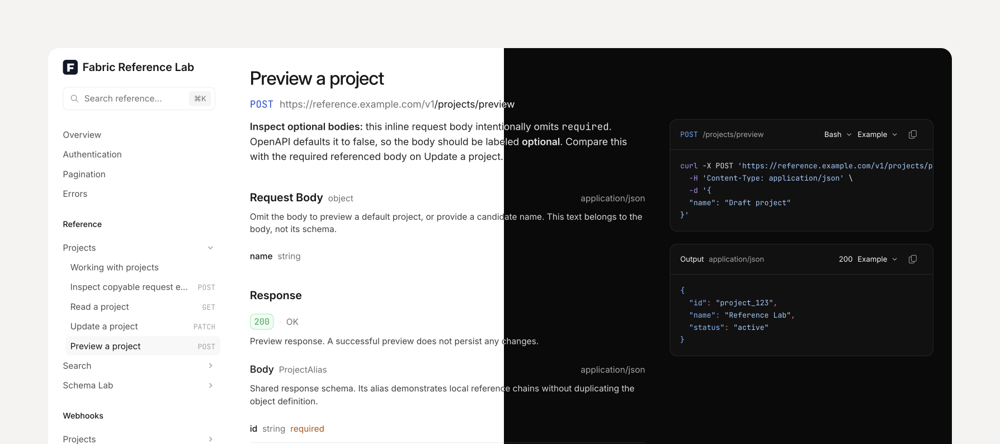

# Fabric



Modern and fast API reference viewer for OpenAPI with custom navigation and guides support.

## Run

```sh
yarn install
yarn dev
```

## Build for CDN embedding

```sh
yarn build
```

This builds only `dist/fabric.js` and `dist/fabric.css`. The JavaScript exposes `window.Fabric`.

For Cloudflare Pages, use `yarn build` as the build command and `dist` as the output directory.

To build the demo site instead, run `yarn build:demo`. `yarn build:lib` is also available for a library build without type checking.
