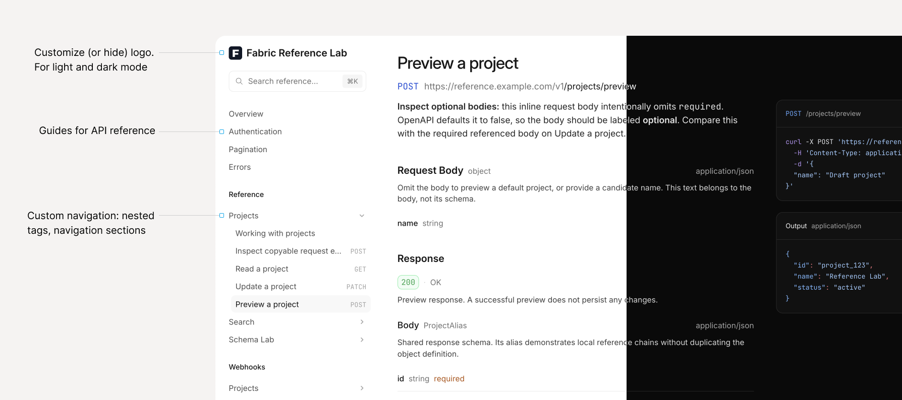

# Fabric
Modern and fast API reference viewer for OpenAPI with custom navigation and guides support.



> [!NOTE]
> Fabric is work in progress and its API may change.

## Use

The simplest way to start with Fabric, is to embed it from CDN and init:

```html
<!doctype html>
<html lang="en">
  <head>
    <meta charset="utf-8">
    <meta name="viewport" content="width=device-width, initial-scale=1">
    <title>API Reference</title>
  </head>
  <body>
    <div id="fabric"></div>
    <script src="https://main.fabric-preview.pages.dev/fabric.js"></script>
    <script>
      Fabric.init('#fabric', {
        openApiDocumentUrl: '/openapi.yaml',
      });
    </script>
  </body>
</html>
```

Replace `/openapi.yaml` with your OpenAPI document URL. 

Full documentation is available at https://fabric.dedoc.co.

## Develop

```sh
yarn install
yarn dev
```

## Build for CDN embedding

```sh
yarn build
```

This builds only `dist/fabric.js`, including its styles. The JavaScript exposes `window.Fabric` and adds the styles to the page when initialized.

